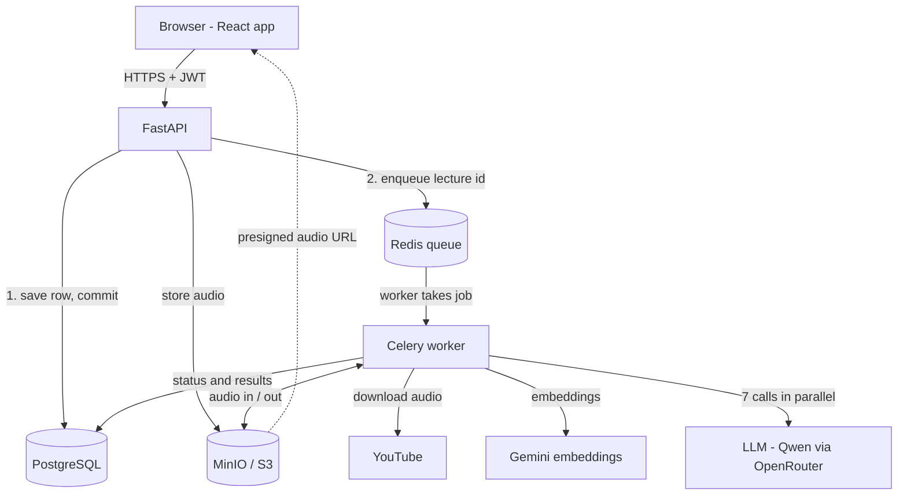

# VoicePilot AI 🎙️

**Turn lecture recordings into transcripts, notes, quizzes and flashcards automatically.**

Upload an audio file, record in the browser, or paste a YouTube link. VoicePilot transcribes it with Whisper in the background, splits the transcript into meaningful chunks, and generates a full study pack with an LLM: summary, structured notes with diagrams, key concepts, a quiz, flashcards, a mind map and timestamped chapters.
---

## Features

- **Three ways to add a lecture:** upload a file (wav, mp3, m4a, webm, ogg, flac), record in the browser, or paste a YouTube link.
- **Background transcription:** Whisper (`small`, int8) runs on Celery workers, so the API answers instantly with `202 Accepted` and the UI updates by itself.
- **Semantic chunking:** Whisper's pause-based segments are regrouped into coherent ideas using embeddings, pause length and a duration cap.
- **Automatic study pack:** as soon as a transcript is ready, the worker generates 7 items in parallel:
  - Summary
  - Markdown notes with Mermaid diagrams and tables
  - Key concepts glossary
  - Quiz with explanations
  - Flip-card flashcards
  - Mind map
  - Timestamped chapters
- **Interactive lecture page:** clickable transcript timestamps that seek the audio, a quiz that checks each answer instantly, and flip cards.
- **HTML export:** the whole study pack as one self-contained page you can print to PDF.
- **Retry without re-uploading:** the original audio stays in object storage, so a failed lecture can be retried in one click.

---

## Architecture



**The key idea: slow work never runs inside an HTTP request.**

1. The API validates the upload and streams it to object storage in 1 MB chunks.
2. It saves a `queued` row in Postgres, commits, then enqueues a small job (just the lecture id) on Redis.
3. It returns `202 Accepted` immediately.
4. A Celery worker downloads the audio, runs Whisper, chunks the transcript and saves it.
5. The worker then chains a second task that generates the study pack.
6. The frontend polls the lecture's status until everything is ready.

### Lecture states

Each lecture has two independent states, so an LLM failure can never mark a good transcript as failed:

| Transcript (`status`) | Study pack (`study_pack_status`) |
| --- | --- |
| `queued` → `downloading` (YouTube only) → `processing` → `completed` / `failed` | `queued` → `generating` → `ready` / `failed` |

---

## Tech stack

| Layer | Technology |
| --- | --- |
| Frontend | React 18, TypeScript, Vite, Mermaid, DOMPurify |
| API | FastAPI, Pydantic, SQLAlchemy |
| Database | PostgreSQL 16 (JSONB for AI output) |
| Queue | Celery + Redis |
| Storage | MinIO locally, S3-compatible (AWS S3 in production) |
| Speech to text | faster-whisper (Whisper `small`, int8, CPU) |
| LLM | Qwen via OpenRouter (Gemini as fallback) |
| Embeddings | Gemini `gemini-embedding-001` |
| YouTube | yt-dlp + ffmpeg + Deno |
| Auth | JWT (python-jose) + bcrypt |
| Infra | Docker Compose |

---

## Engineering highlights

- **Reliable background jobs:** tasks acknowledge late, the visibility timeout is longer than the longest job, and every task is idempotent, so a worker crash causes a safe redelivery instead of a lost job.
- **Commit before enqueue:** the worker can never receive a job for a row that doesn't exist yet.
- **Smart retries:** transient errors (database, storage, YouTube network) retry with exponential backoff and full jitter; permanent errors fail immediately with a user-readable message.
- **LLM output treated as untrusted input:** responses are stripped of reasoning tags and code fences, parsed, unwrapped, and validated item by item before saving.
- **Parallel generation:** the 7 study-pack calls run concurrently with `asyncio.gather`, so the pack takes about as long as the slowest call, and one failure doesn't discard the rest.
- **Concurrency guard:** manual generation returns `409` while the automatic pack is running, preventing duplicate cost and lost updates.
- **Secure storage:** private bucket, UUID object keys per user, short-lived presigned URLs, and ownership checks on every query (IDOR-safe).
- **Strict YouTube validation:** exact-host allowlist (blocks look-alike domains), video-id check, and duration check before anything is queued.
- **Feature flags:** YouTube import and automatic generation can be switched off per environment.

---

## Getting started

### Prerequisites

- [Docker Desktop](https://www.docker.com/products/docker-desktop/)
- An [OpenRouter](https://openrouter.ai/) API key (for Qwen) and/or a [Google AI Studio](https://aistudio.google.com/) key (for Gemini)

### 1. Clone

```bash
git clone https://github.com/Ridhima028/voiceassistant.git
cd voiceassistant/voicepilot-ai
```

### 2. Configure

```bash
cp .env.example .env                  # MinIO admin login used by docker compose
cp backend/.env.example backend/.env  # API keys, database, storage, feature flags
```

Fill in `backend/.env`. At minimum:

- `SECRET_KEY`: generate one with `python -c "import secrets; print(secrets.token_hex(32))"`
- `QWEN_API_KEY` and/or `GEMINI_API_KEY`

### 3. Run

```bash
docker compose up --build
```

The first build takes a few minutes. The first transcription also downloads the Whisper model (about 460 MB), which is cached afterwards.

| Service | URL |
| --- | --- |
| App | http://localhost:5173 |
| API docs (Swagger) | http://localhost:8000/docs |
| MinIO console | http://localhost:9001 |

To run more workers: `docker compose up --scale worker=3`

---

## Configuration

| Variable | Default | Description |
| --- | --- | --- |
| `QWEN_API_KEY` | — | If set, all LLM generation goes to Qwen via OpenRouter |
| `QWEN_MODEL` | `qwen/qwen3-8b` | OpenRouter model id |
| `QWEN_MAX_TOKENS` | `8000` | Cap on each reply |
| `GEMINI_API_KEY` | — | Embeddings, and LLM fallback when no Qwen key is set |
| `GEMINI_MODEL` | `gemini-2.5-flash` | Gemini model for the fallback |
| `MAX_UPLOAD_SIZE_MB` | `200` | Largest accepted upload |
| `MAX_DURATION_MINUTES` | `90` | Longest accepted audio or video |
| `WHISPER_LANGUAGE` | `en` | Transcription language; `auto` to detect |
| `YOUTUBE_IMPORT_ENABLED` | `true` | Set `false` on cloud servers (see limitations) |
| `AUTO_STUDY_PACK` | `true` | Generate the study pack right after transcription |
| `S3_PRESIGNED_EXPIRY_SECONDS` | `900` | How long an audio link stays valid |

---

## API overview

All lecture routes need `Authorization: Bearer <token>`. Full interactive docs are at `/docs`.

| Method | Endpoint | Description |
| --- | --- | --- |
| POST | `/auth/signup` | Create an account |
| POST | `/auth/login` | Get a JWT |
| POST | `/lectures/transcribe` | Upload audio → `202`, queued |
| POST | `/lectures/from-youtube` | Import a YouTube link → `202`, queued |
| GET | `/lectures` | List your lectures |
| GET | `/lectures/{id}` | Full lecture with transcript and study material |
| GET | `/lectures/{id}/transcript?view=semantic\|raw\|plain` | Transcript views |
| GET | `/lectures/{id}/audio-url` | Short-lived presigned audio link |
| POST | `/lectures/{id}/study-pack` | Generate everything |
| POST | `/lectures/{id}/{summary\|notes\|quiz\|flashcards\|key-concepts\|mindmap\|chapters}` | Generate one item (`?regenerate=true` to redo) |
| GET | `/lectures/{id}/export` | Study pack as one HTML page |
| POST | `/lectures/{id}/retry` | Retry a failed lecture |
| DELETE | `/lectures/{id}` | Delete the lecture and its audio |
| GET | `/config` | Public feature flags |
| GET | `/health` | Health check |

---

## Running tests

```bash
cd backend
pip install -r requirements.txt pytest
python -m pytest tests -v
```

The tests cover LLM response parsing and validation, the study pack (parallel generation and partial failures), YouTube URL validation and error handling, and the YouTube feature flag. External APIs are mocked, so no keys or network are needed.

---

## Project structure

```
voicepilot-ai/
├── docker-compose.yml
├── backend/
│   ├── main.py              # FastAPI app, startup, /health, /config
│   ├── celery_app.py        # Celery configuration
│   ├── tasks.py             # Worker tasks: transcription, YouTube import, study pack
│   ├── config.py            # All settings from environment variables
│   ├── routers/             # auth.py, lectures.py
│   ├── services/            # llm, stt (Whisper), semantic_segmenter, storage,
│   │                        # youtube, study_pack, export
│   ├── models/              # SQLAlchemy models
│   ├── schemas/             # Pydantic request/response models
│   └── tests/
└── frontend/
    └── src/
        ├── pages/           # Login, Dashboard, LecturePage
        ├── components/      # Upload, Quiz, Flashcards, Transcript, Mermaid...
        └── services/api.ts  # Single API client (JWT, errors)
```

---

## Known limitations

- **YouTube import is for local use.** YouTube often blocks downloads from cloud servers, and downloading is restricted by YouTube's terms for most videos. It's disabled in the hosted demo; uploading a file always works.
- **CPU transcription is slow** for long lectures; a GPU worker would be several times faster.
- **Very long transcripts** are sent whole to the LLM and may hit context limits.
- **Polling** is used for status updates (every 3 s) rather than server push.

## Roadmap

- [ ] RAG chat: "ask this lecture" with timestamp citations (pgvector)
- [ ] Evaluation set for answer and retrieval quality
- [ ] Map-reduce prompting for long lectures
- [ ] Stale-job sweeper and per-user rate limits
- [ ] Server-Sent Events for live status
- [ ] Production deployment

---

## Author

**Ridhima Goyal**: B.Tech CSE (AI), KIET Deemed To Be University · [GitHub @Ridhima028](https://github.com/Ridhima028)
